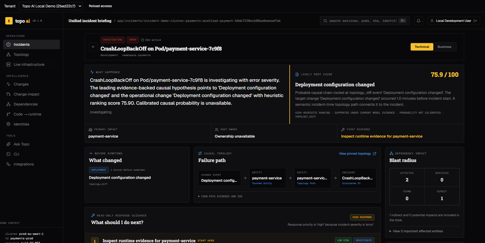
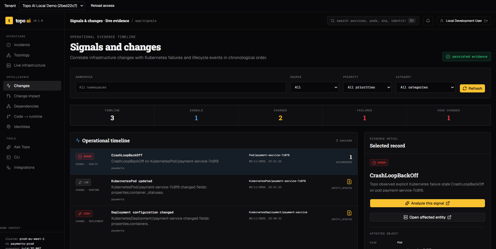
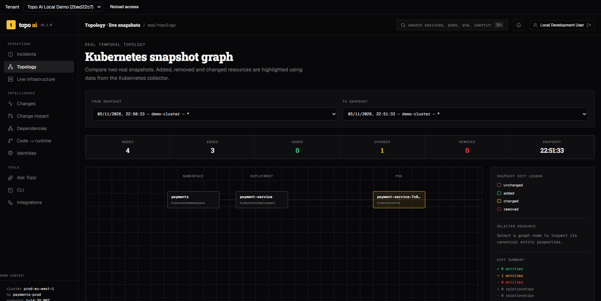
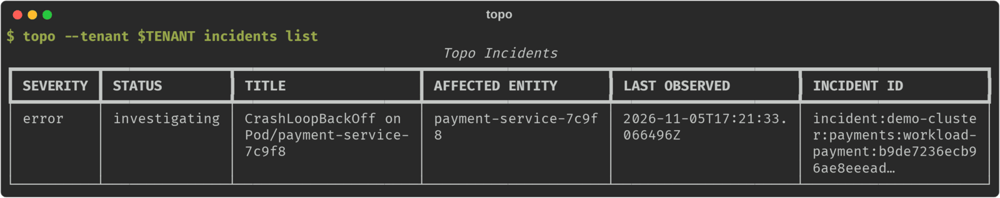
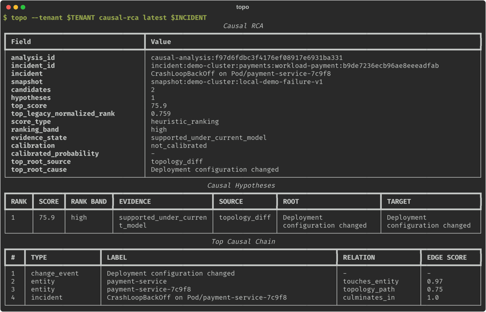
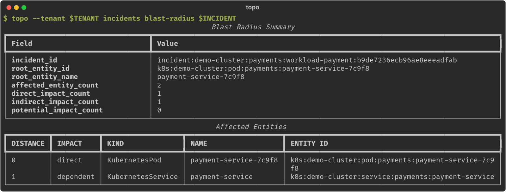

# Topo AI

Topo AI connects infrastructure topology, code and deployment changes, operational signals, and incident investigations with traceable evidence.

  

The full product repository is **[ShaikMuhammadSami/Topo_Ai](https://github.com/ShaikMuhammadSami/Topo_Ai)** (underscore). The similarly named TopoAi and Topo-Ai repositories are separate frontend prototypes, not the full backend and observer-agent product.

> **Local preview only.** This quickstart uses synthetic data, SQLite, and explicitly unauthenticated development mode. It does not provision AWS resources or connect to a Kubernetes cluster. Keep the services bound to localhost. Do not use these settings for a shared, internet-facing, or production deployment.

> **Independent evaluation:** Follow the concise [Local Evaluation Guide](docs/LOCAL_EVALUATION.md) to run the Docker demo, investigate it with the real CLI, and optionally test a disposable Docker Desktop Kubernetes workload with the Topo Agent.

## Run the local demo

Requirements:
- Docker Desktop or Docker Engine with Docker Compose v2.20+
- Git
- Python 3.11+ for the optional smoke-check script and observer agent

Clone the repository and create your local environment file:

~~~bash
git clone https://github.com/ShaikMuhammadSami/Topo_Ai.git
cd Topo_Ai
cp .env.example .env
~~~

On Windows PowerShell, use the following instead of the copy command above:

~~~powershell
Copy-Item .env.example .env
~~~

Build and start the backend and frontend:

~~~bash
docker compose up --build --detach --wait
docker compose exec backend python -m app.demo_seed
python scripts/smoke/local_demo.py
~~~

Open **http://localhost:3000/app**. The API is at **http://localhost:8000** and the local API documentation is at **http://localhost:8000/docs**.

The seed creates a local demo tenant, **Topo AI Local Demo**, with a synthetic, evidence-backed Kubernetes incident scenario:

1. **Baseline:** A healthy `payment-service` Deployment running image `payment-service:v1`.
2. **Deployment change:** The Deployment image changes from `payment-service:v1` to `payment-service:v2`. Topo detects and persists this change.
3. **Runtime failure:** One minute later, the `payment-service` Pod enters `CrashLoopBackOff`, generating a failure signal and incident.

Topo uses the recorded change, timestamps, and Kubernetes topology relationships to investigate the incident automatically.

To explore the demo:

- **Signals & Changes:** Review the deployment change and subsequent runtime failure.
- **Topology:** Inspect the Deployment, Pod, and their relationships.
- **Incidents:** Open the CrashLoopBackOff incident to view the leading evidence-backed causal hypothesis, causal topology path, blast radius, and read-only response guidance.

The deployment change is presented as a supported causal hypothesis, not a proven root cause. This scenario uses synthetic evidence and does not require a real Kubernetes cluster, cloud credentials, or an LLM.

The seed can be rerun without intentionally duplicating existing demo incidents. However, it preserves existing records rather than resetting the database. For a clean walkthrough after updating the demo scenario, use a fresh local database volume.
The app selects the demo tenant automatically when it is the only tenant. If your local database contains other tenants, select **Topo AI Local Demo** from the **Tenant** selector.

### Useful commands

~~~bash
docker compose ps
docker compose logs -f backend frontend
python scripts/smoke/local_demo.py
docker compose down
~~~

To remove the local database and recreate the sample from scratch:

~~~bash
docker compose down --volumes
docker compose up --build --detach --wait
docker compose exec backend python -m app.demo_seed
~~~

**Warning:** docker compose down --volumes deletes the local SQLite database volume and all data stored in it.

If ports 8000 or 3000 are already in use, change TOPO_BACKEND_PORT or TOPO_FRONTEND_PORT in .env. Pass the matching URLs to the smoke script with --backend-url and --frontend-url.

## Tour of the demo

The screenshots below come from the seeded demo on `main`. Terms such as *tenant*, *signal* and *causal hypothesis* are defined in [GLOSSARY.md](GLOSSARY.md).

### Web app

**Incident workspace** (shown at the top of this page). Open the CrashLoopBackOff incident from **Incidents**. Topo shows the leading causal hypothesis, *Deployment configuration changed*, together with the change that preceded the failure, the causal path from that change to the failing Pod, and the blast radius. The 75.9 / 100 value is a heuristic ranking score, not a probability.

**Changes** lists signals and changes newest first: the CrashLoopBackOff signal, the Pod update, and one minute earlier the `payment-service` Deployment change (high importance).

  

**Topology** compares two snapshots of the cluster and highlights what changed between them.

  

### CLI

The `topo` CLI reads the same data. It connects to `http://127.0.0.1:8000` by default, so only the tenant has to be passed:

~~~bash
python -m pip install -e ./cli
TENANT=$(curl -s http://localhost:8000/api/v1/tenants | python -c "import json,sys; print(next(t['tenant_id'] for t in json.load(sys.stdin) if t['display_name']=='Topo AI Local Demo'))")
topo --tenant "$TENANT" incidents list
INCIDENT=$(topo --tenant "$TENANT" -o json incidents list | python -c "import json,sys; print(json.load(sys.stdin)[0]['incident_id'])")
topo --tenant "$TENANT" causal-rca latest "$INCIDENT"
topo --tenant "$TENANT" incidents blast-radius "$INCIDENT"
~~~

In PowerShell, set the two variables with:

~~~powershell
$TENANT = ((Invoke-RestMethod http://localhost:8000/api/v1/tenants) | Where-Object display_name -eq "Topo AI Local Demo").tenant_id
$INCIDENT = (topo --tenant $TENANT -o json incidents list | Out-String | ConvertFrom-Json)[0].incident_id
~~~

  

`causal-rca latest` shows the stored analysis: one hypothesis, with evidence state `supported_under_current_model`, an uncalibrated ranking score, and the causal chain from the Deployment change to the incident.

  

`incidents blast-radius` lists the entities affected by the failing Pod.

  

## What is live and what is illustrative

The local seed exercises the persisted topology, snapshot diff/change, signal, and incident APIs. The GitHub connector and AWS/Kubernetes observer plugins can be tested separately using the steps below.

The Ask Topo answer panel, the in-browser CLI simulator, and the **Demo context** block at the bottom of the sidebar (cluster `prod-eu-west-1`, "collector connected") are illustrative UI areas with fixed sample values; they do not reflect your tenant or a live connection. The **Integrations** page shows real webhook endpoint configuration. The sample seed does not call an LLM, AWS, or Kubernetes.

## Optional: test GitHub with a public repository

The backend GitHub connector can read public repositories without a token. Add the repository owner and name to your local .env file:

~~~dotenv
TOPO_GITHUB_OWNER=your-github-owner
TOPO_GITHUB_REPO=your-public-repository
~~~

Restart the backend so it reads the new settings:

~~~bash
docker compose up -d --force-recreate backend
~~~

Then, from PowerShell, check the connection and enrich the sample failure snapshot:

~~~powershell
$tenant = (Invoke-RestMethod http://localhost:8000/api/v1/tenants | Where-Object display_name -eq "Topo AI Local Demo").tenant_id
$headers = @{ "X-Topo-Tenant-ID" = $tenant }
Invoke-RestMethod -Headers $headers http://localhost:8000/api/v1/github/connection
$snapshotId = "snapshot:demo-cluster:local-demo-failure-v1"
$encodedId = [uri]::EscapeDataString($snapshotId)
Invoke-RestMethod -Method Post -Headers $headers "http://localhost:8000/api/v1/github/enrich?snapshot_id=$encodedId"
~~~

The enrichment result is stored in the local SQLite database. Private repositories require a separately configured GitHub App and secret-store setup; that is not part of this local quickstart.

## Optional: test AWS EKS and Kubernetes discovery

Live EKS discovery requires your own AWS account, an existing EKS cluster, AWS CLI v2, kubectl, and an AWS identity with the read-only permissions required by the observer plugins. The quickstart does not create or modify cloud infrastructure.

In PowerShell, configure and verify your AWS and Kubernetes access:

~~~powershell
$env:AWS_PROFILE = "your-aws-profile"
$env:TOPO_AWS_PROFILE = $env:AWS_PROFILE
$env:TOPO_AWS_REGIONS = "your-region"
aws sts get-caller-identity
aws eks update-kubeconfig --region your-region --name your-eks-cluster
kubectl get nodes
~~~

Install the observer agent from this repository:

~~~powershell
py -m pip install -e .\agent
~~~

Create a short-lived, single-use enrollment token for the local demo tenant:

~~~powershell
$tenant = (Invoke-RestMethod http://localhost:8000/api/v1/tenants | Where-Object display_name -eq "Topo AI Local Demo").tenant_id
$headers = @{ "X-Topo-Tenant-ID" = $tenant }
$body = @{ label = "local-eks-demo"; expires_in_minutes = 30; max_uses = 1 } | ConvertTo-Json
$enrollment = Invoke-RestMethod -Method Post -Uri http://localhost:8000/api/v1/agents/enrollment-tokens -Headers $headers -ContentType "application/json" -Body $body
~~~

Pipe the token directly to the agent so it is not placed in the command line:

~~~powershell
"$($enrollment.enrollment_token)" | topo-agent enroll --server http://localhost:8000 --name local-eks-agent --cluster your-eks-cluster --plugin aws --plugin kubernetes --token-stdin
~~~

Run plugin diagnostics and collect a snapshot:

~~~powershell
topo-agent plugins doctor --plugin aws --plugin kubernetes
topo-agent collect --plugin aws --plugin kubernetes
~~~

The agent stores its credential using the host operating system's secure credential storage. Collection reads AWS and Kubernetes inventory and submits it to your local Topo AI backend; it does not provision cloud resources. Use a least-privilege identity and review your organization's access policy before testing against a production cluster.

## Security and project status

- The Compose ports bind to 127.0.0.1. Do not expose them while TOPO_AUTH_MODE=development-disabled is enabled.
- Development-disabled authentication is accepted only with SQLite and is not suitable for shared or production use.
- Do not use or copy credentials found in repository history. If GitHub reports a historical secret finding, verify that the credential is revoked before proceeding.
- This repository is governed by the [Topo AI Evaluation-Only License](LICENSE). It permits private, local, non-commercial, non-production evaluation only; it does not grant open-source reuse or commercial-use rights. GitHub's public-repository terms may still allow platform-level viewing and forking; the license is not technical copy protection.
- When reporting a problem, use the **Local demo feedback** issue template. Remove tokens, credentials, customer data, and private URLs from logs before posting.
